<a id="top"></a>

<div align="center">


<a href="https://github.com/DenverCoder1/readme-typing-svg">
</a>

<br>


<br><br>

</div>


## 📖 Sobre este repositorio

> [!NOTE]
> Aquí se concentran las prácticas de **Inteligencia Artificial** de la Ingeniería en Computación (UADY · FMAT). Cada carpeta `Ejercicio_N` corresponde a una tarea, y este README las presenta en orden numérico, del 1 al 8.

<div align="center">


</div>

## 🗺️ Ruta de aprendizaje

```mermaid
flowchart LR
    subgraph F["🧭 Fundamentos y agentes"]
        E1["01 · Aplicaciones de IA"] --> E2["02 · Mundo de Wumpus"] --> E3["03 · Análisis PEAS"]
    end
    subgraph B["🔍 Búsqueda"]
        E4["04 · Búsqueda no informada"] --> E5["05 · Greedy y A*"]
    end
    subgraph M["🧠 Aprendizaje automático"]
        E6["06 · Keras MLP"] --> E7["07 · K-Medias"] --> E8["08 · Próximamente"]
    end
    E3 --> E4
    E5 --> E6
    classDef done fill:#00529B,stroke:#6A0DAD,color:#ffffff,stroke-width:2px
    classDef todo fill:#f5f5f5,stroke:#6A0DAD,color:#333333,stroke-dasharray:5 5
    class E1,E2,E3,E4,E5,E6,E7 done
    class E8 todo
    style F fill:#eef4fb,stroke:#00529B
    style B fill:#f4eefb,stroke:#6A0DAD
    style M fill:#eef4fb,stroke:#00529B
```



## 📚 Índice de ejercicios

<div align="center">

| # | Ejercicio | Área | Estado | Carpeta |
|:---:|:---|:---:|:---:|:---|
| **01** | [Aplicaciones de IA que uso o he usado](#ejercicio-01) | 🧭 Agentes | ✅ | [`Ejercicio_1`](./Ejercicio_1) |
| **02** | [El Mundo de Wumpus](#ejercicio-02) | 🧭 Agentes | ✅ | [`Ejercicio_2`](./Ejercicio_2) |
| **03** | [Análisis PEAS de agentes inteligentes](#ejercicio-03) | 🧭 Agentes | ✅ | [`Ejercicio_3`](./Ejercicio_3) |
| **04** | [Búsqueda no informada en Rumania](#ejercicio-04) | 🔍 Búsqueda | ✅ | [`Ejercicio_4`](./Ejercicio_4) |
| **05** | [Búsqueda informada: Greedy vs A*](#ejercicio-05) | 🔍 Búsqueda | ✅ | [`Ejercicio_5`](./Ejercicio_5) |
| **06** | [Perceptrón multicapa con Keras (Iris)](#ejercicio-06) | 🧠 ML | ✅ | [`Ejercicio_6`](./Ejercicio_6) |
| **07** | [Agrupamiento con K-Medias](#ejercicio-07) | 🧠 ML | ✅ | [`Ejercicio_7`](./Ejercicio_7) |
| **08** | Próximo ejercicio | 🚧 | ⏳ | *Carpeta vacía* |

</div>

<br>

## 🔍 Detalle por ejercicio

<a id="ejercicio-01"></a>

### 📝 Ejercicio 01 · Aplicaciones de IA que uso o he usado

> 📁 **Carpeta:** [`Ejercicio_1`](./Ejercicio_1) &nbsp;|&nbsp; 🏷️ **Área:** Agentes &nbsp;|&nbsp; ✅ **Estado:** Completado

**🎯 ¿De qué trata?** Es una reflexión personal sobre las herramientas de inteligencia artificial que he usado. La entrega, escrita a mano, describe cuatro aplicaciones: **Gemini**, como apoyo para estudiar, investigar y revisar código; **Game AI**, la IA que controla enemigos y NPCs en los videojuegos; **Canva AI**, para generar imágenes base y plantillas; y **Wolfram Alpha**, para validar cálculos matemáticos y consultar datos.

**📦 ¿Qué contiene la carpeta?**

| Archivo | Descripción |
|:---|:---|
| [`Ejercicio_1.pdf`](./Ejercicio_1/Ejercicio_1.pdf) | Entrega manuscrita en PDF con el título *"Aplicaciones de IA que uso o he usado"* y la lista de herramientas con su uso. |

<p align="right"><a href="#top">⬆️ Volver arriba</a></p>

<a id="ejercicio-02"></a>

### 🧩 Ejercicio 02 · El Mundo de Wumpus

> 📁 **Carpeta:** [`Ejercicio_2`](./Ejercicio_2) &nbsp;|&nbsp; 🏷️ **Área:** Agentes basados en conocimiento &nbsp;|&nbsp; ✅ **Estado:** Completado

**🎯 ¿De qué trata?** Usa el clásico entorno del **Mundo de Wumpus**: una cueva de 4×4 con pozos, un Wumpus y oro. El agente debe encontrar el oro y salir sin morir. Se comparan cuatro tipos de agente: **reflejo simple**, **basado en modelo**, **basado en objetivos** y **basado en utilidad**. El reporte también analiza cómo cambia el resultado al mover los pozos de lugar.

> [!IMPORTANT]
> Solo el agente de reflejo simple falla: no tiene memoria, da vueltas hasta agotar los 200 pasos y termina con puntaje -200. Los otros tres salen con el oro.

**📦 ¿Qué contiene la carpeta?**

| Archivo | Descripción |
|:---|:---|
| `Diagrama_Wumpus.jpeg` | Boceto a mano de la cueva 4×4 con la posición del agente, los pozos (P), el oro (G) y el Wumpus (W). |
| [`mi_cueva_4x4.yaml`](./Ejercicio_2/mi_cueva_4x4.yaml) | Configuración de la cueva personalizada: tamaño, posición inicial, Wumpus, pozos, oro, sistema de puntaje y límite de 200 pasos. |
| [`EJ1 - reporte.docx`](./Ejercicio_2/EJ1%20-%20reporte.docx) | Reporte con la evidencia de ejecución, las conclusiones por agente y el análisis de por qué falla el reflejo simple. |
| `M2.png` … `M6.png` | Trazas de ejecución de los agentes. M2 muestra al agente de reflejo simple girando hasta el paso 200 sin conseguir el oro. |
| `MP.png` | Captura de la terminal al cargar `mi_cueva_4x4.yaml` y de la leyenda de símbolos del entorno. |

<p align="right"><a href="#top">⬆️ Volver arriba</a></p>

<a id="ejercicio-03"></a>

### 📐 Ejercicio 03 · Análisis PEAS de agentes inteligentes

> 📁 **Carpeta:** [`Ejercicio_3`](./Ejercicio_3) &nbsp;|&nbsp; 🏷️ **Área:** Agentes &nbsp;|&nbsp; ✅ **Estado:** Completado

**🎯 ¿De qué trata?** Aplica el marco **PEAS** (*Performance, Environment, Actuators, Sensors*) para describir agentes inteligentes. Para cada uno de los ocho agentes se define qué se considera un buen desempeño, en qué entorno opera, qué actuadores usa y qué sensores tiene: asistente virtual de voz, robot aspirador, recomendador de streaming, vehículo autónomo, trading algorítmico, diagnóstico médico asistido, dron de inspección de infraestructura y agente jugador de ajedrez.

**📦 ¿Qué contiene la carpeta?**

| Archivo | Descripción |
|:---|:---|
| [`Ejercicio_3.md`](./Ejercicio_3/Ejercicio_3.md) | Documento en Markdown con el análisis PEAS completo, una sección por cada uno de los 8 agentes. |

<p align="right"><a href="#top">⬆️ Volver arriba</a></p>

<a id="ejercicio-04"></a>

### 🌳 Ejercicio 04 · Búsqueda no informada en Rumania

> 📁 **Carpeta:** [`Ejercicio_4`](./Ejercicio_4) &nbsp;|&nbsp; 🏷️ **Área:** Búsqueda &nbsp;|&nbsp; ✅ **Estado:** Completado

**🎯 ¿De qué trata?** Compara los algoritmos de **búsqueda no informada** (BFS, UCS, DFS, DLS e IDS) para encontrar la ruta de **Oradea a Bucarest** en el mapa de Rumania. Se evalúan la ruta, la profundidad, el costo en kilómetros y los nodos expandidos.

| Algoritmo | Resultado | Carreteras | Costo (km) |
|:---|:---:|:---:|:---:|
| BFS | Solución | 3 | 461 |
| UCS | Solución | 4 | **429** |
| DFS | Solución | 9 | 879 |
| DLS (límite 2) | Cutoff | — | — |
| DLS (límite 3) | Solución | 3 | 461 |
| IDS | Solución | 3 | 461 |

> [!TIP]
> **BFS** encuentra la ruta con menos carreteras, mientras que **UCS** encuentra la de menor costo real en kilómetros. **DFS** no garantiza optimalidad y termina rodeando el mapa occidental.

**📦 ¿Qué contiene la carpeta?**

| Archivo | Descripción |
|:---|:---|
| [`Ejer_1_BnoI.pdf`](./Ejercicio_4/Ejer_1_BnoI.pdf) | Reporte con el subgrafo explorado, la tabla comparativa y el análisis de resultados. |
| `Figure_1.png` | Gráfica del subgrafo de Rumania que compara la ruta de BFS, DFS, DLS e IDS contra la de UCS, con el costo de cada carretera. |
| `SS.png`, `SS1.png` … `SS5.png` | Capturas de la terminal con la ejecución de los algoritmos. |

<p align="right"><a href="#top">⬆️ Volver arriba</a></p>

<a id="ejercicio-05"></a>

### 🎯 Ejercicio 05 · Búsqueda informada: Greedy vs A*

> 📁 **Carpeta:** [`Ejercicio_5`](./Ejercicio_5) &nbsp;|&nbsp; 🏷️ **Área:** Búsqueda informada &nbsp;|&nbsp; ✅ **Estado:** Completado

**🎯 ¿De qué trata?** Compara **Greedy Best-First Search** y **A\*** en el mapa de Rumania, de **Timisoara a Bucarest**. Ambos usan como heurística la distancia en línea recta a Bucarest. A\* encuentra la ruta óptima, mientras que Greedy se desvía porque elige Lugoj solo por tener el menor valor heurístico, sin considerar el costo acumulado de las carreteras.

| Algoritmo | Ruta | Carreteras | Costo (km) | Nodos expandidos |
|:---|:---|:---:|:---:|:---:|
| Greedy | Timisoara → Lugoj → Mehadia → Drobeta → Craiova → Pitesti → Bucharest | 6 | 615 | 6 |
| A\* | Timisoara → Arad → Sibiu → Rimnicu Vilcea → Pitesti → Bucharest | 5 | **536** | 10 |

> [!TIP]
> El reporte muestra que los valores *f* de A\* crecen de forma monótona a lo largo de la ruta. Esto es consecuencia de usar una heurística **consistente**.

**📦 ¿Qué contiene la carpeta?**

| Archivo | Descripción |
|:---|:---|
| [`ejercicio-05-rp-fnl.pdf`](./Ejercicio_5/ejercicio-05-rp-fnl.pdf) | Reporte final con la tabla comparativa, el análisis de por qué Greedy se desvía y la evolución de *f* en A\*. |
| `Sgraph.png` | Gráfica del subgrafo Timisoara → Bucharest con las rutas de Greedy y de A\*, y el valor *h* de cada ciudad. |
| `SS.png`, `SS1.png` … `SS3.png` | Capturas de la terminal con la ejecución de Greedy y A\*. |

<p align="right"><a href="#top">⬆️ Volver arriba</a></p>

<a id="ejercicio-06"></a>

### 🧠 Ejercicio 06 · Perceptrón multicapa con Keras (Iris)

> 📁 **Carpeta:** [`Ejercicio_6`](./Ejercicio_6) &nbsp;|&nbsp; 🏷️ **Área:** Aprendizaje automático &nbsp;|&nbsp; ✅ **Estado:** Completado

**🎯 ¿De qué trata?** Implementa una **red neuronal densa (perceptrón multicapa)** con Keras y TensorFlow para clasificar las tres especies del dataset **Iris** (setosa, versicolor y virginica). Usa codificación *one-hot* en la salida, activación sigmoide, error cuadrático medio (MSE), optimizador SGD con tasa de aprendizaje 0.03 y 500 épocas. Como parte del ejercicio 01 se agregan dos capas ocultas más (topología 4 × 3 × 3 × 3 × 3) y se compara su curva de pérdida con la red original.

**📦 ¿Qué contiene la carpeta?**

| Archivo | Descripción |
|:---|:---|
| [`05 Keras - multilayer perceptron - iris - ejercicio-01.ipynb`](./Ejercicio_6/05%20Keras%20-%20multilayer%20perceptron%20-%20iris%20-%20ejercicio-01.ipynb) | Notebook de Jupyter con la carga de datos, la construcción y entrenamiento de la red, las gráficas de pérdida, una predicción de ejemplo y la comparación con la red profunda. |

<p align="right"><a href="#top">⬆️ Volver arriba</a></p>

<a id="ejercicio-07"></a>

### 📊 Ejercicio 07 · Agrupamiento con K-Medias

> 📁 **Carpeta:** [`Ejercicio_7`](./Ejercicio_7) &nbsp;|&nbsp; 🏷️ **Área:** Aprendizaje no supervisado &nbsp;|&nbsp; ✅ **Estado:** Completado

**🎯 ¿De qué trata?** Aplica **K-Medias (K-Means)**, un algoritmo de clustering no supervisado, sobre datos sintéticos generados con `make_blobs` en dos versiones: una con centros que se solapan y otra con centros separados. Para elegir el número de grupos *k* se usan el **método del codo** (inercia) y el **coeficiente de silueta**, y se visualizan las fronteras de Voronoi. También se exploran la inicialización *k-means++* y la segmentación de colores de una imagen.

> [!TIP]
> Con los centros originales el codo marca *k = 4*, porque tres nubes comparten coordenada horizontal y se solapan. Con los centros separados, el codo y la silueta coinciden en *k = 5* (silueta ≈ 0.83).

**📦 ¿Qué contiene la carpeta?**

| Archivo | Descripción |
|:---|:---|
| [`01_K_medias_copia.ipynb`](./Ejercicio_7/01_K_medias_copia.ipynb) | Notebook completo con el código, las explicaciones teóricas y el reporte final que responde tres preguntas de análisis. Descarga la imagen de la mariquita al ejecutarse. |
| `Orig_blobs_plot.png`, `Orig_codo.png`, `Orig_silueta.png`, `Orig_voronoi_plot.png` | Resultados con los centros originales: dispersión de datos, curva del codo, silueta y fronteras de Voronoi. |
| `Mod_blobs_plot.png`, `Mod_codo.png`, `Mod_silueta.png`, `Mod_voronoi_plot.png` | Los mismos resultados con los centros modificados, donde las cinco nubes quedan separadas. |

<p align="right"><a href="#top">⬆️ Volver arriba</a></p>

<a id="ejercicio-08"></a>

### 🚧 Ejercicio 08 · Próximo ejercicio

> 📁 **Carpeta:** `Ejercicio_8` &nbsp;|&nbsp; ⏳ **Estado:** Pendiente

**🎯 ¿De qué trata?** Aún no tiene contenido. La carpeta está reservada para la siguiente tarea y se documentará aquí cuando tenga entregables.

<p align="right"><a href="#top">⬆️ Volver arriba</a></p>


## 🛠️ Herramientas y tecnologías

<div align="center">


<br><br>


</div>

<details>
<summary><b>🌳 Ver estructura del repositorio</b></summary>

```text
📦 Inteligencia-Artificial/
├── 📁 Ejercicio_1/   ➜ Aplicaciones de IA (PDF manuscrito)
├── 📁 Ejercicio_2/   ➜ Mundo de Wumpus (reporte, YAML, diagrama y capturas)
├── 📁 Ejercicio_3/   ➜ Análisis PEAS (Markdown)
├── 📁 Ejercicio_4/   ➜ Búsqueda no informada (BFS, DFS, UCS, DLS, IDS)
├── 📁 Ejercicio_5/   ➜ Búsqueda informada (Greedy y A*)
├── 📁 Ejercicio_6/   ➜ Perceptrón multicapa con Keras (notebook)
├── 📁 Ejercicio_7/   ➜ K-Medias (notebook y gráficas)
├── 📁 Ejercicio_8/   ➜ Próximamente (vacía)
└── 📄 README.md
```

</details>

<br>


<div align="center">

**Ian Paredes Vázquez** · Ingeniería en Computación · FMAT-UADY

<a href="#top">⬆️ Volver al inicio</a>

</div>
